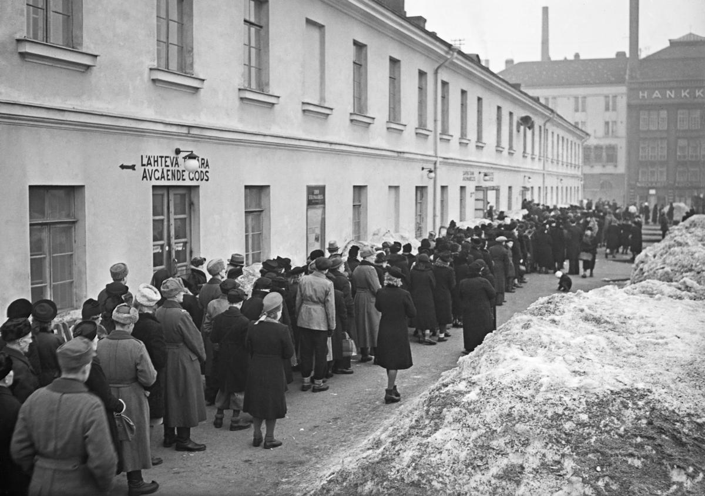

* Jono

#+CAPTION: A queue outside Helsinki bus station before Palm Sunday 31.3.1942. Copyright: Museovirasto / Finnish Heritage Agency
#+ATTR_HTML: :width 300px
#+ATTR_HTML: :align center

Manage and stream your playlists locally in Org mode.

A local queue for playing music / video, or other processes. Powered by [[https://mpv.io][mpv]].

The impetus for Jono was to replicate the play queue functionality familiar from music streaming services, enabling playing and enqueuing tracks from Org mode buffers. With Jono, playlists can be managed locally and be version controlled.

Features [1/11]:
- [X] stream content from Youtube as audio or video
- [ ] add videos to the end ("add to queue") or top ("play next") of the play queue
- [ ] playback controls: play, pause, stop, next
- [ ] enqueue a selection of URLs
- [ ] enqueue an Org mode list URLs or nodes with the URL as property
- [ ] add a queue to queue
- [ ] literal queue format in Org mode
- [ ] query videos from Youtube from Org mode nodes
- [ ] view the play queue in minibuffer
- [ ] show the play queue and progress in an Org mode block
- [ ] use the queue for any sequential processing

* Status

Jono is currently in pre-alpha stage.

* Install

* Usage

* Settings
